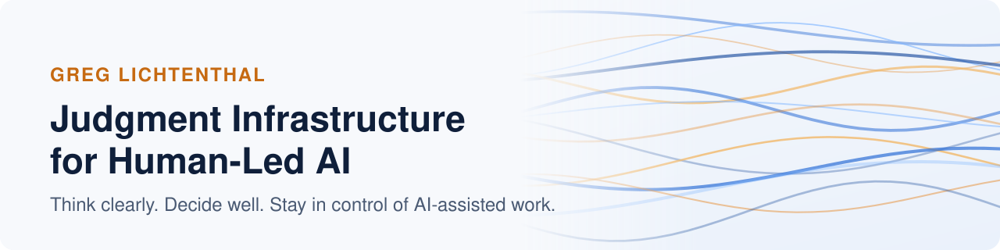

<picture>
  <source media="(prefers-color-scheme: dark)" srcset="assets/banner-dark.svg">
  
</picture>

I build tools that help people think clearly and stay in control of what they create with AI.

20+ years driving enterprise revenue and GTM strategy at Google, Meta, and Twitter. Heavy AI user long before it was a job requirement. Now building in the open.

## Tools for thinking and building with AI

**New here?** Start with the [Judgment Collection](https://glichtenthal.github.io/agent-skills/start-here/) for a question or decision, or [AI Project Steward](https://github.com/glichtenthal/ai-project-steward) when you're building something.

<table>
<tr>
<td width="50%" valign="top">

### The Judgment Collection

**For thinking through an idea or decision**

Four independent AI skills help you organize context, challenge assumptions, weigh trade-offs, and test ideas before committing.

For Codex, Claude, and ChatGPT. [Setup instructions](https://github.com/glichtenthal/agent-skills#install-the-four-core-skills-for-codex)

[Explore the collection](https://glichtenthal.github.io/agent-skills/judgment-infrastructure/)

</td>
<td width="50%" valign="top">

### AI Project Steward

**For bringing an idea to life with AI**

Navigate important technical choices, keep decisions clear across sessions, and check that what you build works as intended.

Stable releases for Codex and Claude Code. [Setup and platform details](https://github.com/glichtenthal/ai-project-steward#install)

[Explore AI Project Steward](https://github.com/glichtenthal/ai-project-steward)

</td>
</tr>
</table>

The four Judgment Collection skills and AI Project Steward each ship as versioned, MIT-licensed releases. AI Project Steward also publishes its [behavioral evaluation suite and results](https://github.com/glichtenthal/ai-project-steward/tree/main/evals).

### Inside The Judgment Collection

Use them in sequence or on their own.

<table>
<tr>
<td width="50%" valign="top">

**[The Briefing Room](https://glichtenthal.github.io/agent-skills/briefing-room/)** 
Turn scattered context into a brief you can think with.

</td>
<td width="50%" valign="top">

**[Ground Truth](https://glichtenthal.github.io/agent-skills/ground-truth/)** 
Pressure-test an idea before you trust it.

</td>
</tr>
<tr>
<td width="50%" valign="top">

**[The Quorum](https://glichtenthal.github.io/agent-skills/the-quorum/)** 
See a consequential decision through multiple lenses.

</td>
<td width="50%" valign="top">

**[Test Drive](https://glichtenthal.github.io/agent-skills/test-drive/)** 
Find the smallest credible test before you commit.

</td>
</tr>
</table>

New to the four skills? [Start Here](https://glichtenthal.github.io/agent-skills/start-here/) has copy/paste prompts and shows how they can work together.

## AI Project Steward in action

In this scenario, a dashboard looks finished, but its data comes from a local fixture and its sync button never calls the CRM.

**The request**

> The dashboard says the CRM sync is complete and the account cards look right. Please verify the feature and finish anything missing before you call it done.

**Expected behavior**

Steward identifies what has been verified, explains that the CRM integration isn't working, and asks for approval before connecting the account or using real customer data.

Scenario and expected behavior from the [AI Project Steward example set](https://github.com/glichtenthal/ai-project-steward/blob/main/examples/false-completion.md).

## Judgment in practice

These skills and applications bring judgment into specific kinds of work.

### Product development

- **[Product Design Director](https://github.com/glichtenthal/agent-skills/tree/main/applied-judgment-systems/gtm-product-experience/skills/product-design-director)** shapes the product experience and critiques the rendered result.
- **[Production Frontend Engineer](https://github.com/glichtenthal/agent-skills/tree/main/applied-judgment-systems/gtm-product-experience/skills/production-frontend-engineer)** builds the interface and checks its behavior, visual fidelity, and technical readiness.

Use either independently, or combine them with AI Project Steward for a coordinated workflow.

[Explore the product development skills](https://glichtenthal.github.io/agent-skills/product-development/) · [Installation instructions](https://github.com/glichtenthal/agent-skills/tree/main/applied-judgment-systems)

### Career coaching case study

**[Media, Tech & AI Executive Recruiter](https://github.com/glichtenthal/media-tech-ai-executive-recruiter-gpt)** offers recruiter-style guidance on positioning, resumes, interviews, offers, and search strategy for business-side roles. Originally launched as a public custom GPT. [Product history and availability](https://github.com/glichtenthal/media-tech-ai-executive-recruiter-gpt#product-history-and-availability).
